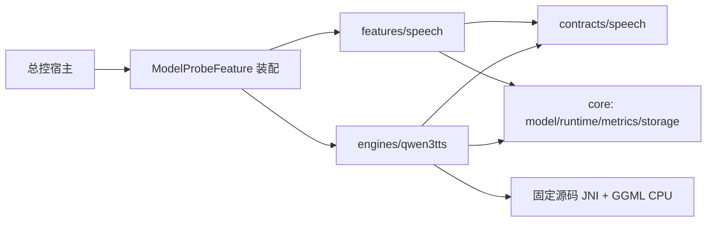

# 本地模型验证 Library 架构草案

阶段1B设计与最小原生实现，2026-10-02。已实现引擎内部的类型化 JNI、排他生命周期及合作取消，并完成 Android Library 编译；页面、通用调度、模型安装和存储仍为下述草案。构建证据及未运行范围以 [SOURCE_MANIFEST.md](SOURCE_MANIFEST.md) 第7节为唯一正文。本轮只为 Qwen 英语 TTS 实例化能力，正式 EnglishApp / 功能1 / 功能2完全隔离。

## 边界与依赖

仍为一个 Android Library，唯一宿主公开入口为 `com.xuesui.englishapp.modelprobe.runtime.ModelProbeFeature()`。Activity、Application、包名、assets 注入、签名及 APK 属总控。下述契约/实现默认 internal，不扩大正式 App 的公共 API。

| 目录 | 责任 | 依赖边界 |
|---|---|---|
| `core/model` | ModelDescriptor、精确文件清单、校验、安装状态、ModelLease | 不认识 Ryan、TTS 参数、Compose 或 JNI |
| `core/runtime` | 加载/释放协调、单任务调度、取消状态、运行事件、受信任适配器注册接口 | 不解析任意 GGUF；不假设输出是音频 |
| `core/metrics` | 单调时间、采样 PSS、热状态、电池温度、通用运行测量 | 通过任务提供的统计补充音频时长/RTF |
| `core/storage` | 模型/结果/设置/报告的私有持久化、原子完成、导出 | 历史不因模型删除而连带删除；无正式 App 目录权限 |
| `contracts/speech` | SpeechRequest、SpeechResult、SpeechSynthesisPort | 任务专属纯类型；无 UI 或 Qwen 实现依赖 |
| `engines/qwen3tts` | 模型 schema、Qwen 参数、能力约束、完整 JNI、native 生命周期 | 实现 speech 契约，使用 core；不依赖语音页面 |
| `features/speech` | 中文测试页面、ViewModel、播放与设置编辑 | 使用 speech 契约/core；不直接访问 native 句柄 |
| `runtime` | 现有入口、依赖装配、显式注册 Qwen 适配器及语音页面 | 只有装配处知道具体实现 |

现在只建立必要实现，不预建聊天/文本/图像空页面或空 Gradle 模块。第二个实际引擎到来时，由总控决定是否拆分 Gradle 模块。

### 阶段1B已实现的内部边界

- `engines/qwen3tts/QwenNativeBindings.kt`：引擎专属参数与结果 DTO、Kotlin 校验、requested/effective 快照、阻塞 JNI 入口。仅验证入口使用，不从占位页面调用；没有通用层依赖这些 Qwen 字段。
- `src/main/cpp/probe_engine.*`：进程内单一 session，整数句柄通过受锁 registry 取得 shared ownership；prepare 生成单次操作 ID，过期 cancel 不影响新任务。load/synthesize/close 用 execution 锁防止运行和释放重叠；close 先取消，再等待 native 退出。错误/取消丢弃本次 PCM 并卸载引擎，后续必须重新 load，不能算 warm run。
- `src/main/cpp/probe_jni.cpp`：明确字段与构造签名、UTF-16/UTF-8 转换、C++ 异常边界；R8 keep 规则保持所需成员。effective 仅在实际进入 synthesize 调用后返回，随机 seed 在调用前解析为显式非负值。
- `vendor/`：固定 CPU 源子集；取消原子量具有进程寿命，CPU abort 回调不保存 Java/单次请求指针。加载分块读、预填充/生成/解码检查与实际 CPU graph abort 是合作式停止；OS I/O、GGUF 元数据解析、内存分配、单个 CPU 节点/张量转换仍可能延迟响应。
- 目前文件入口只验证精确名字、同目录、实际长度与加载后能力。完整 SHA256/原子安装/ModelLease 仍属于阶段2的 `core/model`；当前只允许总控已校验且保持不变的精确文件用于验证，不能把此 JNI 当成任意文件导入功能。

这些生命周期约束已有代码与编译证据；Android JNI/原生契约测试尚未在设备执行，真实加载、取消阶段和重新运行仍需验收。取消延迟或不存在竞态不能仅凭编译结果宣称已验证。

## 契约草案

- `ModelDescriptor`：稳定 modelId、modelVersion、taskId（如 `speech.synthesis.v1`）、engineId/engineVersion、runtime/format、文件 role/name/revision/bytes/SHA256、license、ABI、能力/参数 schemaVersion。引擎版本须包含上游 SHA 与本地补丁身份；量化组合以独立模型配置区分。
- `EngineRegistration`：编译时受信任适配器与它明确接受的模型描述集合。注册并不等于已安装或已验证；任意同后缀文件不能进入可用列表。不动态加载外来代码，不自动下载模型。
- `ModelLease`：校验后的精确私有路径和生命周期令牌；持有期间不能删除/替换文件。适配器不可绕过 lease 扫描其他目录或静默挑选不同模型。
- `RuntimeCoordinator.run<Request, Result>(request, runner)`：调度通用任务 envelope；runner 保持请求/结果的静态类型。core 只处理 runId、模型租约、参数快照、取消和 ArtifactRef，不放 TTS speaker/audio 字段，也不使用无约束的 Any/字符串参数袋。
- `SpeechRequest`：本地文本、固定英语、完整段落/逐句模式、类型化 SpeechParameters、执行策略。`SpeechResult`：音频引用、实际采样率/样本数、有效参数快照、任务测量、完成/取消/失败/可能截断状态。语音参数 schema/额外指令能力由适配器拥有，不能散落在 core。
- `RunRecord`：reportSchemaVersion、runId、模型文件与引擎身份、requested/effective 参数、文本 SHA256/词句数、运行条件、结果 artifact/hash、测量、错误类别和验证层级。报告默认不含私有正文；页面与私有草稿可保留用户编辑文本，不进入源码、日志或自动上报。

## 参数与能力驱动

界面先读取适配器的类型化参数定义（键、类型、默认、范围、支持条件、schemaVersion），再与已加载模型能力取交集。缺参数接线、未知模型版本或能力不一致时显示不可用及原因，不能自动映射到相似模型。设置按 `modelId + engineVersion + schemaVersion` 保存；升级需要显式迁移或告知用户恢复默认，运行中的快照不随设置变化。

| 配置 | 首期拟定默认 / 校验 | 生效条件与说明 |
|---|---|---|
| 模型 | 1.7B CustomVoice + Q4 talker/Q4 codec | 必须两个指定 hash 全通过；Q8/0.6B 是独立对照项 |
| 语言 / 音色 | 英语 2050 / Ryan；可选 Aiden | 从该模型实际 speaker metadata 校验；其他命名音色可在高级选择中明确原生语言，不声称英语听感相同 |
| instruction | 空；最多 512 个 Unicode code points | 仅 1.7B 当前 capability 开启；此长度是 App 防误输入限制，不是上游模型极限 |
| CPU 线程数 | `min(4, 可用逻辑处理器数)`；1…可用逻辑处理器数 | 调用真实 backend setter 并回读；不是 `params.n_threads` 占位字段 |
| temperature | 0.9；有限数 0…2 | 0 明确标为 greedy 调试，默认使用采样 |
| top-k / top-p | 50 / 1.0；整数0…2048 / 有限数(0,1] | 0关闭 top-k；App 范围策略与模型版本绑定 |
| repetition penalty | 1.05；有限数1…2 | 当前实现作用于 CB0；不声称分别控制每个 codebook |
| max audio tokens | 拟定1024；整数1…4096 | 原生默认4096，App 为段落试验拟定较低初值；触顶保留“可能截断”，不是自动成功 |
| seed | 拟定42；-1或0…2^31-1 | 本模块 JNI 补齐后才开放；-1由适配器每次解析为显式非负随机值并记录有效 seed |
| 播放速度 | 1.0；0.5…2.0 | 属播放器后处理；不进入模型生成能力，不改变保存音频的原始时长和 RTF |

以上是待验证的 App 参数策略，不能称为手机调优最佳值。保留上游稳定采样默认；所有浮点值拒绝 NaN/Infinity，JNI 再验证一次。没有专门的模型语速、GPU/NPU 或独立 subtalker 参数开关。保存/恢复默认必须覆盖全部真实生成参数。

## 运行、取消与缓存

状态至少为 `Absent → Verifying → Installed → Loading → Ready → Running → Cancelling → Ready/Error`，保存结果为单独原子步骤。单个 coordinator 串行化模型加载、全局 CPU backend 配置和推理；UI 控制请求立即返回，计算在工作线程。允许停止请求与工作线程并行设置原子标志，但必须等 native 确认退出后释放句柄/租约。失败或 abort 后若无法证明 native 状态可复用，则销毁并重新加载；不把该次列为成功 warm run。

阶段1B已采用本模块 JNI 直接接 C++；对 load 循环、frame loop、prefill/decode CPU abort 的最小补丁在 `vendor/LOCAL_CHANGES.patch` 留痕。后续调用者不能以 Coroutine.cancel、停止播放、抛异常越过 C 边界或立即 free 模型冒充停止推理。若实测无法可靠退出，上报阻塞。阶段2的 ViewModel 需保持旋转时的任务归属；退出页面请求取消，不留下失去所有者的计算。当前无需 Service/录音权限。

默认完整段落一次批量合成，逐句测试独立选择，保留原句顺序/标点，记录分句算法版本、每段 seed 和拼接策略；不能用分句结果充当完整段落结果。批次有限（拟定1…5次，默认3），逐次保存，不并发加载多个模型。任何失败/取消停止剩余批次。

缓存键包括原始文本精确字节的 SHA256、两个模型 hash、engineVersion/补丁身份、schemaVersion、语言/音色/instruction、全部有效生成参数、推理模式/分句版本。requested seed=-1 时每次生成新 effective seed，因此重新生成不会误用旧随机音频。播放/重播始终绑定选定 RunRecord，界面显式区分“此结果参数”与“下次生成设置”。播放器速度不改变生成缓存键。

`cold` 表示释放旧句柄后重新载入且绕过结果缓存；不声称清空 OS 文件缓存或整机重启。`warm` 表示同一驻留引擎、相同条件再次真实推理。`cache` 表示复用历史音频，不参与推理速度统计。更换模型/引擎/运行配置记录新条件，不能混成同组比较。

## 私有存储与测量

- 模型：宿主内置资产或 SAF 调试导入 → 私有 staging → 长度/SHA256/格式白名单校验 → 同文件系统原子安装。模型组合整体 Ready；失败不替换当前有效模型。当前不加入下载器。预留内容寻址文件引用与租约，避免两组模型共享 codec 时误删。
- 结果：每次 run 独立目录保存 WAV 与 versioned JSON；临时文件完整写入后原子完成。完成标记仅在二者一致时写入；失败/取消单独留记录，不作为完整音频缓存。模型/临时缓存/历史分别管理，删除模型不删除既有结果。
- 设置：小型 schema JSON 原子保存；历史索引可从已完成的 RunRecord 恢复，当前不引入正式 App 数据库。未来如需数据库，只做显式向前迁移，不 destructive migration。
- 样例：只读宿主 `assets/probe-sample.txt`。缺失时显示缺失并禁用默认样例生成；允许用户主动输入。恢复样例重新读该资产，不提供假正文；源 DOCX 不在本任务范围。
- 导出：用户通过 SAF 选择目标，导出所选运行 WAV/JSON；播放器处理独立于生成记录。无网络上传，无访问正式 EnglishApp 的文件接口。

测量时钟采用 Android `elapsedRealtimeNanos()`，native 阶段采用 steady_clock。加载、文本处理、生成+解码、文件保存分别记录；批量 RTF=(原生生成+解码秒数)/(实际样本数/采样率)，不混入播放速度或缓存命中时间。另保留端到端耗时，避免把缺少 JNI 分阶段指标时的总时间冒充精确分阶段值。未来如启用流式实现，其 generation 内已含 decode，不能再次相加。

PSS 采用定时采样（拟定200ms，保存实际时间戳/间隔/样本数），称“采样峰值”，不称瞬时绝对峰值或 native RSS。记录热状态、电池温度、ABI/系统/线程/后端、模型和引擎身份。批量 first PCM 不可测则为 null，首 codec frame 与播放器首声不能代替。报告分列 compile / host / device / user-listening；缺证据保留 unknown，不自动提升验收。

## 第二个不同任务模型加入时

增加其精确 ModelDescriptor、`engines/<id>`、任务专属 `contracts/<task>` 和 `features/<task>`，在 runtime 装配处显式注册及添加页面入口。复用模型校验/租约、运行排他、取消状态、通用测量和存储；文本任务返回自身 token/文本结果和专属指标，不实现 SpeechSynthesisPort，不伪造 WAV/RTF。新模型拥有自己的参数 schema 与迁移，禁止读取 Qwen 参数内部实现。只有实际出现的公共需求才提取共享接口或请求总控拆模块。

## 后续验收顺序

先按来源清单补原生接线、取消和 ELF 检查，再以总控提供的完整校验模型验证参数生效与实际合成；这些差异验证通过后才进入完整 UI。阶段2覆盖样例缺失、损坏/hash、安装原子性、参数迁移/范围、租约/生命周期、真实取消与重复生成、音频时长/RTF、缓存隔离、WAV/JSON一致性和SAF导出。原生 mock 只能证明调度/契约，不能替代模型或设备证据；APK与用户实机验收由总控统筹。
