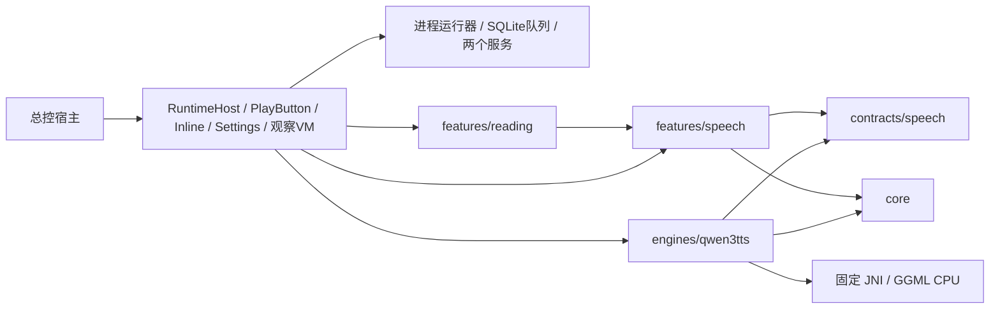

# 共享本地语音 Library 架构

0.4.0后台语音候选，2026-10-14。正式生成/播放继续嵌入文章，语音Tab仅设置；保留独立测试和兼容入口。新宿主契约、服务/数据库/依赖及验收边界唯一详细记录见 SOURCE_MANIFEST 第14节。此前各节设备/失败证据按原范围保留。以下标明历史版本的实现描述由本节当前运行期规则覆盖。

## 边界与依赖

仍为单个Android Library。正式宿主接 `com.xuesui.englishapp.modelprobe.runtime.SpeechInlineReadingFeature(documentId, request, modifier)` 与 `SpeechSettingsFeature(modifier)`，Activity内容根增加 `SpeechRuntimeHost()`，播放槽注入 `SpeechReadingPlayButton(documentId,request,modifier)`；同包ModelProbeFeature、SpeechFeature(request,onClose)及SpeechReadingScope/SpeechReadingRequest字段完整兼容。Activity、Application、包名、assets、签名与APK由总控维护；两个Manifest服务类需供Android实例化，领域与调度类型仍为internal，JNI只用于本模块。正式App与测试App各用自己的私有目录，不互读或自动迁移。

| 目录 | 已实现责任 | 依赖边界 |
|---|---|---|
| `core/model` | ModelDescriptor、严格清单、完整校验、原子安装、ModelLease | 不认识 Qwen 参数、Compose 或 JNI |
| `core/runtime` | TaskRunner 单工作线程、WorkToken、取消与退出协调 | 不假定任务输出是音频 |
| `core/metrics` | MetricsProvider、Android 单调时钟、PSS/热状态/电池温度采样 | 不计算语音专属 RTF |
| `core/storage` | 私有文件边界、原子 JSON、RunStore、SettingsStore | 通用 artifact 与报告事务，不依赖 Qwen |
| `contracts/speech` | SpeechParameters、SpeechEngine、SpeechRequest、SpeechAudio、失败快照 | 任务专属类型，无 UI 或具体引擎依赖 |
| `engines/qwen3tts` | 受信任模型描述、类型化参数、参数编辑器/摘要、JNI 适配 | 实现 speech 契约并使用 core；不依赖语音页面 |
| `features/speech` | SpeechService、PCM16 WAV及合并、诊断页面、纯播放状态机、页面偏好 | 使用任务契约和core；不引用具体引擎、runtime ViewModel或native句柄 |
| `features/reading` | 范围规划、段内有限重试、自然段账本状态转换、播放意图、历史分组 | 使用speech契约与持久化接口；不访问文章模块、导航或Android数据库 |
| `runtime` | 入口/观察VM、进程运行器、SQLite适配、生成FGS、MediaSession服务、SAF与生命周期 | 唯一具体装配处，选择Qwen编辑器/适配器；不读取文章数据库或导航 |

ModelCatalog 只接收 runtime 显式注册的 ModelDescriptor。清单描述数据，不能注册代码；没有任意 GGUF 扫描、动态后端、下载器或其他任务的空页面。本次没有重写原生实现；其句柄/操作 ID/合作取消约束沿用来源清单第7节。

## 模型与私有存储

根目录是宿主的 `noBackupFilesDir/model-probe-v1/`，子目录分为 `models`、`results`、`cache-index`、`settings`；新增本模块 `speech-queue.sqlite3`。不访问其他模块数据库或管理端文件。源资产与私有副本分离，源样例只在页面内存中用于编辑/恢复；报告保存正文 SHA-256、字符数和近似词数，不写入正文；仅私有SQLite队列保存断点恢复所需的冻结正文，不放入Intent/Bundle或日志。

ModelStore 在受控 staging 内顺序复制两个文件，同时验证完整长度和 SHA-256，fsync 后把完整 generation 原子切换为当前版本。失败或取消保留旧安装，不产生半个 Ready 模型。空间检查使用当前 usableSpace，要求新副本总长加 64 MiB；重装时旧副本尚在，所以需要额外一整套空间。不会主动回收其他应用缓存。

加载取得 ModelLease 后才进入适配器；同一私有根的租约在进程内共享，旧页面仍在退出时，新控制器不能删除或替换它持有的模型。每个新 ModelStore 实例首次加载校验完整副本；同实例未变化的长度/mtime 可沿用校验记录，显式“校验”始终计算完整 SHA-256。受控清理拒绝越界/符号链接路径，只清理本模块自己的未引用 generation/staging。

RunStore每次运行创建独立临时目录，完成artifact哈希与报告后原子提交。失败/取消丢弃未完成WAV，保存失败报告；未提交目录不进入历史。同根活动草稿在进程内登记，防止新控制器误清理活动写入。播放、缓存读取与导出前核对长度和SHA-256。原诊断列表仍为最近100条；正式音频管理按父子关系列出所有项目，读取轻量管理元数据，不为每个历史片段常驻完整采样数组。

模型删除保留结果；“清理缓存”仅移除缓存索引，既有 WAV/报告继续可播放和导出。新增任务库初始schema1，未知升级/降级显式失败而不删库；不修改其他数据库。

## 设置与真实能力

参数定义、校验和界面由 Qwen 适配器拥有。装配层通过 Composable 插槽把编辑器及参数摘要交给通用语音页面；页面不会解析 Qwen 内部字段。加载后的能力由 JNI 返回，语气指令据实际 capability 启用。仅提供 Ryan/Aiden 英语选择；Q8/0.6B 显示未提供且不可选择。

| 设置 | 默认值与约束 | 含义 |
|---|---|---|
| 模型 | 1.7B CustomVoice Q4 talker + Q4 tokenizer | 必须符合固定两文件描述 |
| 语言 / 音色 | 英语2050 / Ryan；可选 Aiden | 加载器检查模型 metadata |
| instruction | 空；无 NUL、最多512个 Unicode code point | App 输入限制；模型须支持 |
| CPU 线程 | min(4,逻辑处理器数)；1…逻辑处理器数 | 原生 CPU setter/getter，记录 effective |
| temperature | 0.9；有限数0…2 | 0为 greedy 调试 |
| top-k / top-p | 50 / 1.0；整数0…2048 / 有限数(0,1] | top-k=0关闭筛选 |
| repetition penalty | 1.05；有限数1…2 | 当前原生实现作用于 CB0 |
| 最大音频帧 | 1024；整数1…4096 | 触顶保留可能截断状态 |
| seed | 42；-1或0…2147483647 | -1先解析为显式随机 seed |
| 模式 / 暖运行批次 | 完整段落 / 3；可选逐句，批次1…5 | 多次连续测试仅用于暖运行 |
| 播放速度 | 1.0；0.5…2.0 | Media3 播放变速，不改变原始 WAV/RTF |

数字编辑保留原始输入，非法值会阻止生成/保存，不回退使用旧有效值。所有生成参数在 Kotlin 与 JNI/C++ 两层校验。没有独立模型语速、GPU/NPU 或未接线的采样开关；默认值只是实验策略，未认定为手机最佳配置。

设置按 modelId + engineVersion 保存。外层 SettingsStore schema=2，内容为 generation（Qwen schema=1）与 speech（页面偏好 schema=1）。保存和恢复默认同时覆盖生成参数、模式、批次、播放速度。0.3.1仅显式兼容adapter2到adapter3的原schema2设置：新版本尚未保存时只读旧配置，原文件保留，模型文件身份不变。其他引擎或未知/损坏schema显示恢复默认原因；只有显式保存才写当前版本。

## 运行、取消与生命周期

唯一进程级ProbeController/TaskRunner拥有模型，生成前台服务驱动跨文章FIFO；UI ViewModel仅观察与发命令。数据库、校验播放文件和SAF使用独立I/O线程，不排在长时推理之后。WorkToken 可以在原生回调登记之前或之后接收取消。页面分开显示“已请求取消”和实际工作线程退出；线程/原生尚未返回时保持 busy/cancelling，不提前释放模型。

适配器持有 lease 至阻塞式 native close 返回。失败/取消卸载模型，下次需要重新载入。切页面/Tab/ON_STOP/Compose销毁和Activity ViewModel清理不取消生成或播放。生成服务主动预算为5小时50分钟（350分钟），partial wake lock兜底为预算加1分钟（351分钟）；同一运行实例不因后续启动指令续期，系统共享时限可能更早经onTimeout终止，不自动重启绕过限额。移除keepScreenOn。超时请求合作取消、异步写中断并立即停止前台服务，不在主线程join/free native；旧工作线程实际退出前不能启动第二任务。明确诊断加载可保持驻留用于warm测试，正式持久队列完成/停止后释放模型。

原生合作取消仍受系统 I/O、GGUF 元数据解析、内存分配、张量转换和单个 CPU 节点约束。页面提供“JNI无模型契约自检”：创建/关闭、预取消、过期取消隔离、非法参数拒绝；其报告标为 jni_contract_only_no_model，不能替代加载中的取消或 CPU graph 中断测试。

正式及旧保存音频统一使用Media3服务；控制代次、当前目标和播放意图阻止用户暂停/切目标后的迟到回调启动旧声音。MediaSession系统控制、音频焦点及noisy暂停独立于生成。每次播放绑定已选历史 runId，结果参数与当前编辑设置分开呈现。SAF 导出在打开选择器前固定 runId；失败/取消尝试删除本次新建的不完整文档，若提供方拒绝删除则告知用户。没有广泛存储权限或网络上传。

## 冷启动、暖运行、逐句与缓存

- cold：卸载旧引擎，校验/载入，再真实推理；绕过结果缓存。它不等于清空 OS 文件缓存或手机重启。
- warm：要求引擎已驻留并真实推理。批次1…5次顺序执行，整批固定文本、设置及一次解析后的随机 seed；失败、取消或触顶立即停止剩余批次。
- cache：仅在用户显式选择时读取匹配历史音频，校验后生成独立缓存记录；RTF、推理耗时和采样测量为 null。随机 seed 请求不能直接查询同参数缓存。

完整段落默认原样一次合成。逐句模式使用 Locale.US BreakIterator，最多64句，去除片段边缘空白、保留顺序与标点，不额外加入静音；算法标识为 breakiterator-en-v1-no-added-silence。每句 seed 为本次显式 base seed + index（31位范围取模），结果逐片段保存实际 effective 配置。原生返回 token limit 时保存已返回的部分 WAV，标记可能截断，停止剩余句子且不进入缓存。

缓存键覆盖精确文本、模型 fingerprint/revision/文件哈希、引擎/补丁/适配器版本、参数 schema、全部有效生成参数（含线程、instruction、seed）、模式及分句算法。实际返回参数与预期不一致、无明确EOS、全静音或非有限PCM不作为成功。缓存身份为speech-cache-v2-validated-output，避免复用旧验证规则下的音频。播放速度不影响生成缓存键。

## 报告与测量

RunStore 报告 schema=1，记录模型/引擎身份、运行方式、requested、各段实际 effective、WAV 样本数/采样率/哈希、测量及验收状态。失败原生调用只有返回了 effective 才记录 failedSegmentEffective，未进入推理不编造参数快照。

WAV 为单声道 PCM16；从实际 FloatArray 顺序写入，检查 NaN/Infinity、采样率一致性和文件大小，记录限幅样本数。音频时长=样本数/采样率；RTF=(native generateMillis + decodeMillis)/1000/音频秒数。逐段同时保留 tokenize、generate、decode、native total。loadMillis 是原生加载耗时；端到端 elapsedMillis 还包含私有校验等外围工作，但不含最终报告提交。0.3.1新增原生textTokens、generatedFrames、generationSteps、EOS/触顶、prefillMillis及tokenGenerationMillis；prefill含提示构建/图准备/KV初始化/预填充前向，generateMillis仍含这些阶段。WAV写入及fsync单独计时；报告最终哈希/提交仍不计入elapsedMillis。firstPcmLatencyMillis继续为null。

Android 端使用 elapsedRealtimeNanos 单调计时；PSS 以200ms固定延迟采样，保留真实时间戳、最大实际间隔、样本数、错误数、采样峰值。最多保留6000条，超过后保留前5999条与最新一条并标记截断；峰值仍汇总全部成功采样。温度是电池温度，热状态是 Android 等级，均不可冒充 CPU 温度；PSS 不是瞬时绝对峰值。报告另含 ABI、系统、设备、逻辑处理器数和实际页大小。

真实调用返回成功只能记录 nativeReturnedSuccessfully，compatibilityGate 仍 pending；听感与断网验收不会因构建或一次成功返回自动通过。

## 后续不同任务模型

新增精确 ModelDescriptor、受信任 engines/<id>、任务专属 contracts/<task> 和 features/<task>，由 runtime 显式装配并增加入口。复用 core 的安装、租约、任务排他、取消、通用采样、事务存储；新任务返回自身结果/指标，不实现虚假的语音接口或 WAV/RTF。新引擎自行拥有参数 schema 与显式迁移，不引用 Qwen 内部实现。是否拆分 Gradle 模块留给实际第二引擎加入时由总控决定。

当前证据见SOURCE_MANIFEST第14节；旧第9节单次试听与第13节失败/修复范围均不被提高为0.4.0设备通过。

## 历史：0.2.0兼容入口与段内队列（生命周期已由0.4.0替代）

SpeechFeature的request=null入口从空白输入/粘贴开始，不读取probe-sample.txt，也不会因缺少样例阻塞。ModelProbeFeature继续使用原样例与诊断UI。正式入口收到请求只展示预览和设置，用户点击生成才计算。FULL取所有英文段落，PARAGRAPH必须有有效索引，SENTENCE必须非空且是指定段落的精确子串；越界或不匹配显示错误，不回退到全文。

ReadingPlanner最多接收256段、100000个UTF-16字符；原段/唯一句定位保持，只有选中段参与内容合法性校验。预览/保留身份使用800码点的规范分片，执行时按参数重规划：Qwen取clamp((maxAudioTokens-64)/2,24,400)码点，优先句/词边界，最多1024片。该预算是保守启发式，不保证EOS；不删编号/正常数字、不补写文本。功能1已按target元数据去学习编号，缓存和正文身份均针对收到的干净字符串。

队列仅对token_limit按原句/词边界一分为二，单支最多2层、整请求最多32次重分片、总叶子最多1024；不加大用户帧上限，不重试取消、原生异常或无词边界的短片。未触发重试时仍为baseSeed+index；发生重试后按实际尝试序号派生seed并逐次报告。被替换的失败尝试只保留为证据，不把它的PCM再拼入最终成功音频；childRunIds覆盖全部尝试以便引用/回收。最终未恢复片仍可保留明确标token_limit的部分音频，但不会成为最新成功或缓存。

父报告新增attempts（输入hash/长度、requested与effective来源、终止/PCM/阶段时间）、初始/最终计划数、重分片数、timing与firstCompletedSegmentMillis。此首片指标是第一次完整子WAV提交的耗时，不是流式首PCM或已自动播放；正式条仍播放完整父音频。阶段汇总仅累加已返回且可测的片段，缓存不算新推理；异常原生调用缺失细分耗时须看freshAttempts与覆盖数，不用0代替不可测。

ReadingInbox按requestId去重；新ID同文本可进入，忙时保留待切换请求，用户确认停止后等待原任务真实退出再打开新预览，不自动生成。正式两个入口共享同Activity的speech-runtime ViewModel和任务串行器，ReadingEntryMemory分别保存独立页草稿与文章请求状态。request=null恢复自己的输入，返回模式由本次入口参数决定；旋转/重复重组不重复消费或启动生成。

ReadingQueue顺序调用SpeechService，每片先保存WAV和子报告，再开始下一片；优先复用正文/模型/参数全部匹配的缓存，随机seed仍真实生成。整次只解析一个显式base seed，逐片派生；group报告保留原requested与resolved base，子报告记录实际effective。失败、取消或有限触顶恢复耗尽才停止余下队列，保留已完成片段；只有全部最终片段成功或命中缓存才标完整完成。

子报告新增可选reading上下文（session/request ID、标题、范围、片段及原文offset），不保存正文。最后把可用子WAV按原顺序流式合并成独立PCM16 WAV与speech.reading.v1父报告，不额外加静音；部分完成明确标注，合并失败仍保留子文件。取消后的保存只完成已有片段的事务，不启动新的native任务。进程在父报告提交前结束时，已经提交的子音频作为可恢复历史显示；不会隐藏或自动续跑。

历史按父报告存在关系及显式子引用分组，长队列的子报告不会挤掉整篇项目；父报告未提交时保留可恢复片段，已被其他父记录重用的片段不误显示为孤儿。0.3.0正式管理不截断为100条。旧诊断报告仍可识别，私有目录、设置schema2、模型fingerprint及引擎参数schema1未变，无数据库或破坏式迁移。

## 历史：MediaPlayer播放与低版本方案（现改用Media3）

两个入口共用SpeechPlayback状态机和AndroidAudioFactory。异步prepare、暂停/原位置继续、完成后重播、焦点丢失暂停、页面退出停止，都以播放代次阻止迟到回调。倍速0.5–2.0，Android端显式pitch=1；暂停时先保存新倍速，继续时才应用，避免setPlaybackParams的隐式启动行为。不支持的设置报错并释放播放器，不声称已经生效。媒体提供方或系统能力仍以设备实测为准。

正式页突出Ryan/Aiden、自然/慢速/轻快指令预设、可编辑个性化要求和播放倍速；高级采样参数完整保留。风格预设写入同一个真实instruction字段并原样持久化/进入缓存及报告，生成快慢是定性要求，没有虚构native数值速度。保存/恢复默认沿用全部生成参数及页面偏好，无新参数schema迁移。

Library minSdk改为29，native也实际以aarch64-linux-android29重新编译，不使用tools:overrideLibrary。现用热状态API从29提供，播放器倍速等API更早；API29的Lint与NDK链接验证见当前证据。ABI仍仅arm64，低于能力的设备在入口显示不支持而不调用生成。目标Android16与API29真机的新流程均待总控验收。

页面/后台退出会请求取消并在真实退出后卸载模型；选择SAF文档期间仅停止播放，避免把文件选择器当成离开页面而启动卸载、丢失导出回调。正式页返回只调用宿主onClose，不修改文章、滚动或默写状态；已有结果继续保存。

## 历史：0.3.0文章内嵌与仅设置入口（运行归属已由0.4.0替代）

新正式入口使用Activity自身的ViewModelStore和固定speech-runtime键，避免宿主导航的局部ViewModel作用域生成第二个运行器。设置页仅模型准备/校验/释放/删除副本、音色/指令/高级生成参数、播放倍速、保存/默认；不调用ReadingScreen，无正文输入、生成、播放器或历史列表。

Inline条适配宿主底部最大180dp的槽：范围及“更多”占一行，生成/取消与播放/暂停/继续占一行，普通字体可展示单行状态；大字体隐藏该次要行，不缩小触点。详细状态、停止播放、历史、导出和删除确认使用对话框。控件不声明BackHandler、文章编辑器或滚动容器；只有显式打开的弹窗拥有自己的列表滚动/关闭。宿主需在文章存续期保持底部槽在Composition中，不放进随滚动回收的LazyColumn item；它的dispose用于识别真正离开文章。旋转由同Activity ViewModel保留任务，不重新生成。

documentId作为不透明身份（本次word-memory:<notebookId>）校验并参与hash，绝不拼入文件路径。请求只准备范围，推理仅由点击触发。当前文章/选区变化立即停止旧播放、清除错配选择；忙时提示正在取消上一范围，等待真实退出，随后只读取新范围的已保存结果，不自动生成。正文或生成参数变化会将旧结果标为不匹配，旧文件仍可导出；不会用它冒充当前范围/设置。标题或requestId变化不产生新的保留身份。

保留身份是documentId、scope、非全文的段索引及句子身份经hashParts得到的key；正文切片另有bodyKey，全生成参数另有settingsKey，匹配同时核对模型fingerprint与engineVersion。唯一句继续用原first/last sentence逻辑位置，key和定位字段保持兼容。按2026-10-06收尾决定，同段完全相同的选中文字重复出现时，句子身份改用带repeated前缀的精确内容hash，同文同段共享一个音频范围，与出现次数、标题/requestId及音色/seed无关；只朗读一次选中文字，长句仍按原上限分片。跨文/段或不同精确文本仍隔离。

重复句从首个匹配处提取只为取得那份相同文字，不代表知道用户选择了第几次出现。标签统一为“第N段 · 单句（重复文本）”；retention及父items/新子reading报告标occurrence=unspecified和matchingOccurrences，具体sentenceRange/firstSentence/lastSentence/startOffset/endOffset在相应报告位置为null。唯一句为occurrence=unique且保留原具体位置。复用子报告保留原来源元数据，父报告记录本次选区，不改写旧来源；不按内容把旧唯一句历史自动迁入新重复句身份。空/不存在/越界等原文校验不放宽，公开请求字段不变。

## 最新结果事务、引用与删除

`results/catalog.json`是新增schema1索引，包含latest、pending发布意图与garbage回收集合。父报告schema1新增可选retentionKey/retention/settingsKey/childRunIds；子报告reading新增可选retentionKey。先保存并fsync音频及完整哈希报告，登记发布意图，再原子rename结果目录；重新验证新音频/报告及子引用后，将latest切换与旧版回收意图一同原子写入catalog，最后才回收旧文件。失败、取消、触顶或合并失败的父报告不进入latest。保存失败/进程中断保留旧latest；恢复对存在且完整的待发布目录完成切换，对不存在的目录撤销意图。已激活结果的回收失败独立提示并重试，不把已经完成的生成报为失败。

回收先计算可达引用：未删除父记录、最新索引以及进程内活动租约都保护自身和子片段。需回收的目录先原子改名为.trash-<id>再逐文件删除，ledger直到实际完成才去掉该ID；进程中断后可重试，不让半删报告占住已提交命名空间。删除相关缓存指针；无效缓存指针可丢弃，不以缓存索引阻止永久回收。私有目录、runId、artifact路径及清理树拒绝越界/符号链接；遇到无法确定引用的损坏记录，停止相关回收并显示待重试问题，不扩大删除。

新内嵌缓存命中直接引用既有子结果，不复制新的片段WAV；items明确记录reused/cache及来源runId。父结果仍保留独立完整WAV，以支持连续MediaPlayer播放和一次SAF导出；子WAV用于按片段复用、来源验证及中断恢复，故父/子有效音频可能约双份占用。替换/删除父项目时只回收无其他父记录/租约引用的源片段，当前仍引用的共享片段可继续精确缓存复用，最后引用消失后回收。不会随每次重生成累积整套旧WAV。

播放校验开始前取得租约，播放器实际release后才归还（暂停仍持有）；SAF选择器打开前固定ID并持有导出租约，取消选择或完成拷贝后归还；队列生成/合并持有源片段租约。用户确认删除时停止播放，工作中则排队，导出或共享引用尚在时登记待回收；不会提前移除正在使用的文件。删除范围仅本宿主私有results/cache-index，模型、文章、其他数据库、仓库文件及用户已导出文档都不在这条清理链。

升级不猜测旧记录归属：无稳定retention身份的0.1/0.2项目继续保留并可手动删除；同标题、正文hash或随机requestId不是自动合并依据。独立旧生成记录即使作为新父项目的缓存源，也保留其独立所有权，删除父项目不会自动删除它。新子报告的稳定retentionKey可以证明父提交前中断的孤儿片段归属，之后该范围成功生成可安全回收无引用旧片段。没有用户数据库迁移或开发机真实资料清理。

## 0.3.1 单段恢复与设备边界

同一活动范围的新requestId/重组不再启动重复历史读取任务；离开后再次进入仍读取一次。读取最新结果异常必须清除switching并显示原因；生成门控拒绝有明确说明。失败、触顶、取消后由真实worker退出释放busy；下一次显式选择/生成重新核对target和参数。播放仍要求当前逻辑范围、正文/参数/模型/engineVersion与最新成功一致；旧完整音频不因失败被删。控件尺寸和导航不变，动态进度使用实际预算/重分片后的总数。

这些修复不证明用户001按钮与怪音的真实故障已复现或修好。SOURCE_MANIFEST第13节严格区分JVM模拟、Android源码/AAR编译、原始FULL失败样本及待设备同文A/B。新原生只增加观测和EOS判定；模型、采样算法、重复惩罚、KV/解码策略未改。

## 0.4.0自然段任务、发布与播放

RuntimeHost在Activity前台可见时初始化/连接进程运行器，恢复queued/interrupted；不要求进入阅读页，不恢复出声。一个模型worker跨诊断、兼容和正式入口共享；SQLite账本与引用操作有独立I/O和发布锁。UI设置可以修改，但任务冻结的原文、配置/引擎摘要、实际随机seed保持不变。自然段预留2048个attempt seed序号，段内沿用原有有限分片重试。失败暂停本篇；用户明确重试后继续，其他文章按FIFO处理。

RunStore先提交校验过的自然段WAV/报告，pending_run与持久pins在跨文件/SQLite事务之间保护它。SQLite事务同时发布DONE和latest_audio，之后对照账本裁剪pins并回收旧版。崩溃后的RUNNING+已完整提交草稿可完成发布；未提交段重做，已成功子片可按精确身份复用。单纯内存Lease不承担进程死亡保护。播放/全文导出持有独立持久pin；整篇历史任务完成后，旧任务元数据不会独占已被更新的音频文件。

FULL以自然段播放列表存在，不长期保存整篇合并WAV；每个自然段内仍有父/子PCM副本以支持校验/片段恢复。全文导出在SAF选择前冻结并pin当前段序列，返回后临时顺序拼接、完成或失败都清临时文件，下次进程恢复清理遗留临时文件。进程在系统选择器期间被终止需重新发起导出。

直接播放入口只接FULL/PARAGRAPH。缺失必须确认；补齐时复用已确认音频（随机模式亦保留既有实际seed），只为缺段生成。显式“仅播放已有”冻结实际段号列表；补齐模式遇缺段等待而不跳读。Media3每次仅送当前自然段，完成后再选下一段，暂停/换目标对异步校验与生成完成加代次检查。SENTENCE仍走原明确选区生成/最新音频链。

旧PARAGRAPH只有明确稳定retention身份时才纳入新索引；旧FULL/单句/无稳定身份项目继续在管理中播放/导出/删除，不按标题或全文hash猜拆。完整精确服务/权限、数据库schema与宿主接线清单见SOURCE_MANIFEST第14节；后台/焦点/时限/通知/实机声音仍以设备执行为准。
