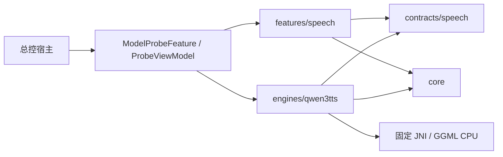

# 本地模型验证 Library 架构

阶段2实现，2026-10-03。当前为设备验证候选；构建、测试、产物与验收边界的唯一证据正文见 [SOURCE_MANIFEST.md 第8节](SOURCE_MANIFEST.md#8-阶段2追加设备验证候选)。本轮只注册 Qwen 英语语音任务；正式 EnglishApp 与其他功能没有接线。

## 边界与依赖

仍为单个 Android Library，唯一宿主公开入口为 `com.xuesui.englishapp.modelprobe.runtime.ModelProbeFeature()`。Activity、Application、包名、assets、签名与 APK 由总控维护。新增业务类型均为 internal，原有 JNI 也只用于本模块。

| 目录 | 已实现责任 | 依赖边界 |
|---|---|---|
| `core/model` | ModelDescriptor、严格清单、完整校验、原子安装、ModelLease | 不认识 Qwen 参数、Compose 或 JNI |
| `core/runtime` | TaskRunner 单工作线程、WorkToken、取消与退出协调 | 不假定任务输出是音频 |
| `core/metrics` | MetricsProvider、Android 单调时钟、PSS/热状态/电池温度采样 | 不计算语音专属 RTF |
| `core/storage` | 私有文件边界、原子 JSON、RunStore、SettingsStore | 通用 artifact 与报告事务，不依赖 Qwen |
| `contracts/speech` | SpeechParameters、SpeechEngine、SpeechRequest、SpeechAudio、失败快照 | 任务专属类型，无 UI 或具体引擎依赖 |
| `engines/qwen3tts` | 受信任模型描述、类型化参数、参数编辑器/摘要、JNI 适配 | 实现 speech 契约并使用 core；不依赖语音页面 |
| `features/speech` | SpeechService、PCM16 WAV、运行/缓存策略、SpeechScreen、SpeechActions、页面状态/偏好 | 使用任务契约和 core；不引用具体引擎、runtime ViewModel 或 native 句柄 |
| `runtime` | ModelProbeFeature、ProbeViewModel，装配引擎及编辑器、SAF、MediaPlayer、生命周期 | 具体 Qwen 实现只在此处选择和接入页面 |

ModelCatalog 只接收 runtime 显式注册的 ModelDescriptor。清单描述数据，不能注册代码；没有任意 GGUF 扫描、动态后端、下载器或其他任务的空页面。本次没有重写原生实现；其句柄/操作 ID/合作取消约束沿用来源清单第7节。

## 模型与私有存储

根目录是宿主的 `noBackupFilesDir/model-probe-v1/`，子目录分为 `models`、`results`、`cache-index`、`settings`。不访问正式 App 或管理端文件。源资产与私有副本分离，源样例只在页面内存中用于编辑/恢复；报告保存正文 SHA-256、字符数和近似词数，不写入正文。

ModelStore 在受控 staging 内顺序复制两个文件，同时验证完整长度和 SHA-256，fsync 后把完整 generation 原子切换为当前版本。失败或取消保留旧安装，不产生半个 Ready 模型。空间检查使用当前 usableSpace，要求新副本总长加 64 MiB；重装时旧副本尚在，所以需要额外一整套空间。不会主动回收其他应用缓存。

加载取得 ModelLease 后才进入适配器；同一私有根的租约在进程内共享，旧页面仍在退出时，新控制器不能删除或替换它持有的模型。每个新 ModelStore 实例首次加载校验完整副本；同实例未变化的长度/mtime 可沿用校验记录，显式“校验”始终计算完整 SHA-256。受控清理拒绝越界/符号链接路径，只清理本模块自己的未引用 generation/staging。

RunStore 每次运行创建独立临时目录，完成 artifact 哈希与报告后原子提交。失败/取消丢弃未完成 WAV，保存失败报告；未提交目录不进入历史。同根活动草稿在进程内登记，防止新控制器误清理旧控制器还在写的结果。播放、缓存读取与导出前核对保存的文件长度和 SHA-256。历史页面列最近100条，未自动删除更旧的已完成记录。

模型删除保留结果；“清理缓存”仅移除缓存索引，既有 WAV/报告继续可播放和导出。没有数据库迁移或删库行为。

## 设置与真实能力

参数定义、校验和界面由 Qwen 适配器拥有。装配层通过 Composable 插槽把编辑器及参数摘要交给通用语音页面；页面不会解析 Qwen 内部字段。加载后的能力由 JNI 返回，语气指令据实际 capability 启用。仅提供 Ryan/Aiden 英语选择；Q8/0.6B 显示未提供且不可选择。

| 设置 | 默认值与约束 | 含义 |
|---|---|---|
| 模型 | 1.7B CustomVoice Q4 talker + Q4 tokenizer | 必须符合固定两文件描述 |
| 语言 / 音色 | 英语2050 / Ryan；可选 Aiden | 加载器检查模型 metadata |
| instruction | 空；无 NUL、最多512个 Unicode code point | App 输入限制；模型须支持 |
| CPU 线程 | min(4,逻辑处理器数)；1…逻辑处理器数 | 原生 CPU setter/getter，记录 effective |
| temperature | 0.9；有限数0…2 | 0为 greedy 调试 |
| top-k / top-p | 50 / 1.0；整数0…2048 / 有限数(0,1] | top-k=0关闭筛选 |
| repetition penalty | 1.05；有限数1…2 | 当前原生实现作用于 CB0 |
| 最大音频帧 | 1024；整数1…4096 | 触顶保留可能截断状态 |
| seed | 42；-1或0…2147483647 | -1先解析为显式随机 seed |
| 模式 / 暖运行批次 | 完整段落 / 3；可选逐句，批次1…5 | 多次连续测试仅用于暖运行 |
| 播放速度 | 1.0；0.5…2.0 | MediaPlayer 后处理，不改变原始 WAV/RTF |

数字编辑保留原始输入，非法值会阻止生成/保存，不回退使用旧有效值。所有生成参数在 Kotlin 与 JNI/C++ 两层校验。没有独立模型语速、GPU/NPU 或未接线的采样开关；默认值只是实验策略，未认定为手机最佳配置。

设置按 modelId + engineVersion 保存。外层 SettingsStore schema=2，内容为 generation（Qwen schema=1）与 speech（页面偏好 schema=1）。保存和恢复默认同时覆盖生成参数、模式、批次、播放速度。引擎版本变化或未知/损坏 schema 显示恢复默认原因，旧文件保留；只有用户显式保存才写入当前配置，没有静默跨版本沿用。

## 运行、取消与生命周期

TaskRunner 串行化校验、安装、加载、推理、保存和导出。UI 只发请求；WorkToken 可以在原生回调登记之前或之后接收取消。页面分开显示“已请求取消”和实际工作线程退出；线程/原生尚未返回时保持 busy/cancelling，不提前释放模型。

适配器持有 lease 至阻塞式 native close 返回。失败/取消卸载模型，下次需要重新载入。退出页面或进入后台请求取消并停止播放；旋转由 ViewModel 保持运行归属。onCleared 先请求取消，再排队等待真实退出后关闭资源，不用 shutdownNow 假装中止 native。运算期间仅设置页面 keepScreenOn，不新增服务或唤醒锁权限。

原生合作取消仍受系统 I/O、GGUF 元数据解析、内存分配、张量转换和单个 CPU 节点约束。页面提供“JNI无模型契约自检”：创建/关闭、预取消、过期取消隔离、非法参数拒绝；其报告标为 jni_contract_only_no_model，不能替代加载中的取消或 CPU graph 中断测试。

MediaPlayer 使用异步准备和音频焦点，回调核对播放器身份及播放代次，避免退出页面后迟到回调自动开始播放。每次播放绑定已选历史 runId，结果参数与当前编辑设置分开呈现。SAF 导出在打开选择器前固定 runId；失败/取消尝试删除本次新建的不完整文档，若提供方拒绝删除则告知用户。没有广泛存储权限或网络上传。

## 冷启动、暖运行、逐句与缓存

- cold：卸载旧引擎，校验/载入，再真实推理；绕过结果缓存。它不等于清空 OS 文件缓存或手机重启。
- warm：要求引擎已驻留并真实推理。批次1…5次顺序执行，整批固定文本、设置及一次解析后的随机 seed；失败、取消或触顶立即停止剩余批次。
- cache：仅在用户显式选择时读取匹配历史音频，校验后生成独立缓存记录；RTF、推理耗时和采样测量为 null。随机 seed 请求不能直接查询同参数缓存。

完整段落默认原样一次合成。逐句模式使用 Locale.US BreakIterator，最多64句，去除片段边缘空白、保留顺序与标点，不额外加入静音；算法标识为 breakiterator-en-v1-no-added-silence。每句 seed 为本次显式 base seed + index（31位范围取模），结果逐片段保存实际 effective 配置。原生返回 token limit 时保存已返回的部分 WAV，标记可能截断，停止剩余句子且不进入缓存。

缓存键覆盖精确文本、模型 fingerprint/revision/文件哈希、引擎/补丁/适配器版本、参数 schema、全部有效生成参数（含线程、instruction、seed）、模式及分句算法。实际返回参数与预期不一致的运行也不写缓存索引。播放速度不影响生成缓存键。

## 报告与测量

RunStore 报告 schema=1，记录模型/引擎身份、运行方式、requested、各段实际 effective、WAV 样本数/采样率/哈希、测量及验收状态。失败原生调用只有返回了 effective 才记录 failedSegmentEffective，未进入推理不编造参数快照。

WAV 为单声道 PCM16；从实际 FloatArray 顺序写入，检查 NaN/Infinity、采样率一致性和文件大小，记录限幅样本数。音频时长=样本数/采样率；RTF=(native generateMillis + decodeMillis)/1000/音频秒数。逐段同时保留 tokenize、generate、decode、native total。loadMillis 是原生加载耗时；端到端 elapsedMillis 还包含私有校验等外围工作，但不含最终报告提交。未提供独立精确保存耗时或流式首PCM指标，firstPcmLatencyMillis 为 null。

Android 端使用 elapsedRealtimeNanos 单调计时；PSS 以200ms固定延迟采样，保留真实时间戳、最大实际间隔、样本数、错误数、采样峰值。最多保留6000条，超过后保留前5999条与最新一条并标记截断；峰值仍汇总全部成功采样。温度是电池温度，热状态是 Android 等级，均不可冒充 CPU 温度；PSS 不是瞬时绝对峰值。报告另含 ABI、系统、设备、逻辑处理器数和实际页大小。

真实调用返回成功只能记录 nativeReturnedSuccessfully，compatibilityGate 仍 pending；听感与断网验收不会因构建或一次成功返回自动通过。

## 后续不同任务模型

新增精确 ModelDescriptor、受信任 engines/<id>、任务专属 contracts/<task> 和 features/<task>，由 runtime 显式装配并增加入口。复用 core 的安装、租约、任务排他、取消、通用采样、事务存储；新任务返回自身结果/指标，不实现虚假的语音接口或 WAV/RTF。新引擎自行拥有参数 schema 与显式迁移，不引用 Qwen 内部实现。是否拆分 Gradle 模块留给实际第二引擎加入时由总控决定。

下一步是总控生成独立候选 APK 并安排设备验证，精确资产契约与检查表见来源清单第8节。已有模块证据直接沿用，只补宿主包装和设备执行范围。
